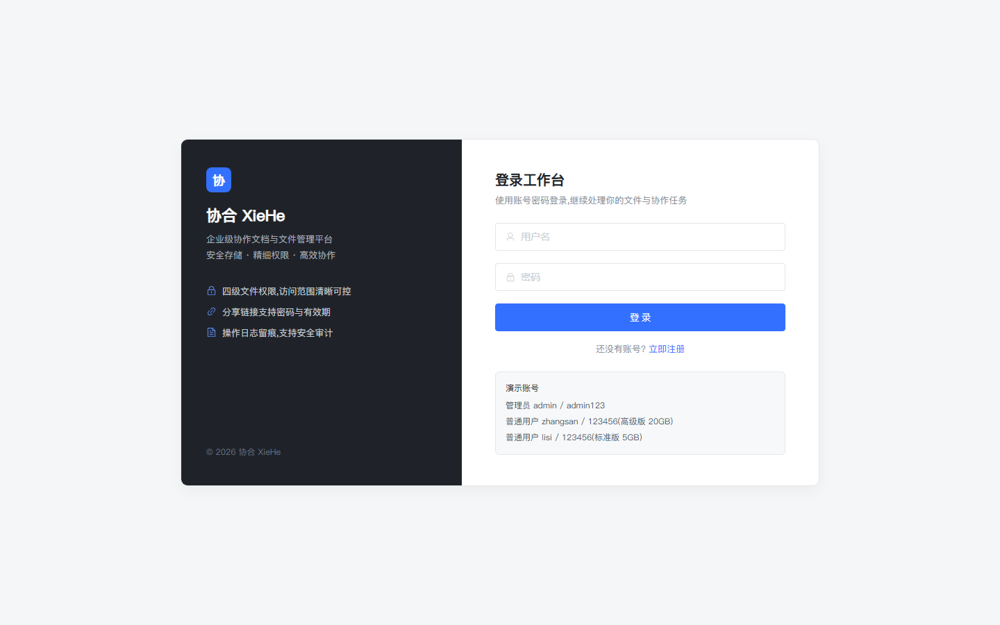
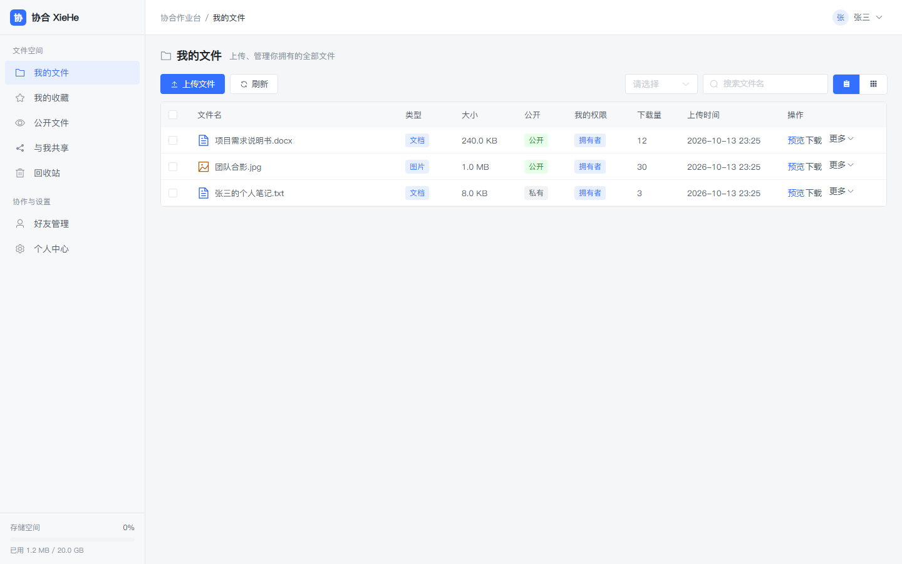
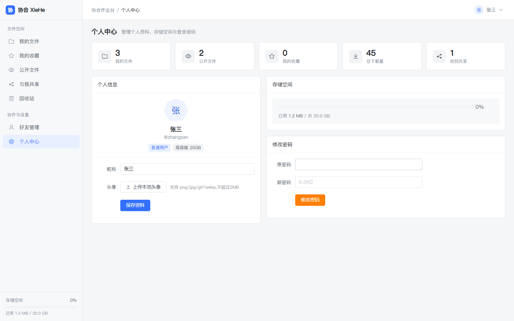
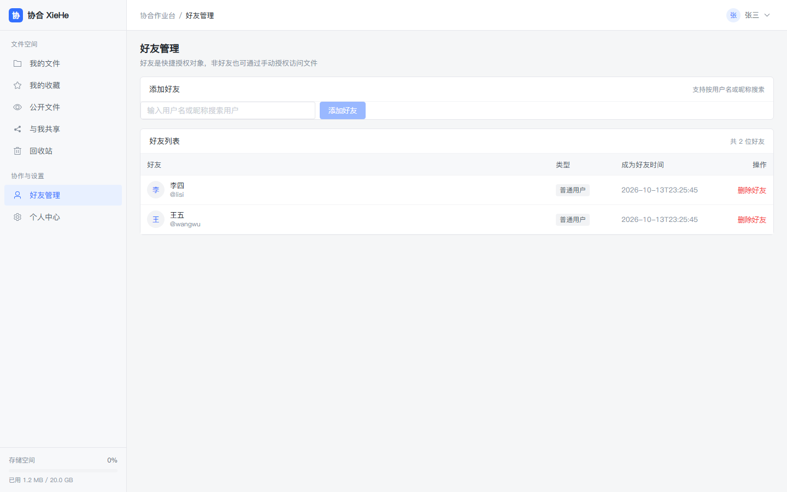
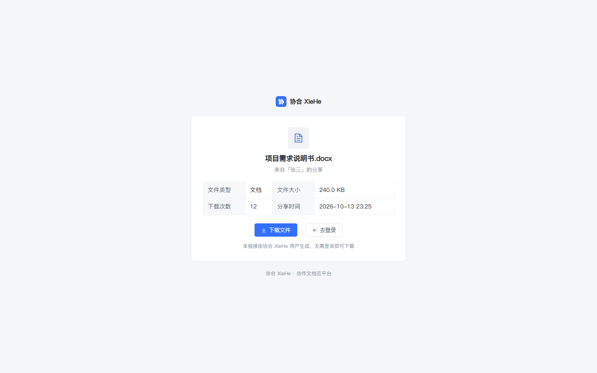
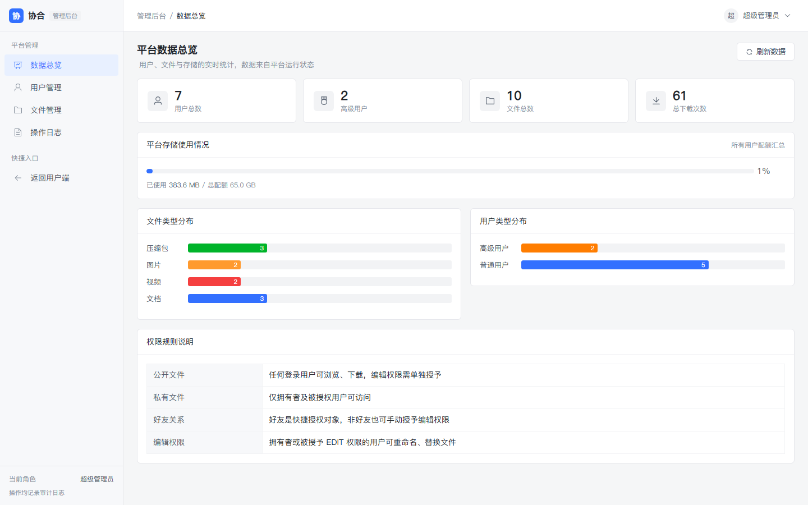

# 协合 XieHe · 协作文档云平台


面向个人与小团队的协作文档云平台。提供文件上传、在线预览、四级权限、好友协作、分享链接、回收站与管理后台，前后端分离，可直接部署到生产环境。

> 当前版本：**v1.4（工程化与视觉重构版，2026-10）**  
> 技术栈：Spring Boot 2.7.18 + JDK 17 + MyBatis-Plus + MySQL 8 + Redis + JWT ｜ Vue 3.4 + Vite 5 + Element Plus + Pinia  
> 文档说明：本 README 为项目唯一完整文档，涵盖架构、数据模型、接口、部署、操作、测试与版本记录；`docs/images` 仅保留演示截图。

---

## 项目简介

协合 XieHe 解决小团队在文件协作中的三个高频问题：**文件给谁看、谁能改、外部分享如何控权**。

- **文件全生命周期**：上传、下载、文本预览、重命名、内容替换、收藏、回收站、彻底删除。
- **精细权限**：`OWNER > EDIT > VIEW > NONE` 四级模型，Service 层强制校验，不依赖前端隐藏按钮。
- **分享可控**：免登录分享链接，支持访问密码与有效期，可批量生成、随时取消。
- **协作闭环**：好友关系作为快捷授权入口，非好友也可手动授权。
- **管理可审计**：用户禁用/升级、文件治理、操作日志（操作人 / 动作 / IP / 时间）。

项目在 v1.4 完成了企业级工程化加固与全站 UI 重构：密码迁移 BCrypt、请求链路追踪、安全响应头、日志落盘、分页上限、优雅停机、Actuator 健康检查，以及对标飞书云文档的浅色、低装饰界面体系。

---

## 功能演示

### 登录与文件工作台

| 登录页                              | 我的文件                                 |
| ----------------------------------- | ---------------------------------------- |
|  |  |

### 个人中心与好友协作

| 个人中心                                | 好友管理                                |
| --------------------------------------- | --------------------------------------- |
|  |  |

### 免登录分享页与管理后台

| 分享落地页                          | 管理后台 · 数据总览                             |
| ----------------------------------- | ----------------------------------------------- |
|  |  |

> 管理后台还包含用户管理（`docs/images/07-admin-users.png`）、文件管理、操作日志三个子模块，入口仅对 `ADMIN` 角色开放。

---

## 功能清单

### 用户端

| 模块     | 能力                                                                              |
| -------- | --------------------------------------------------------------------------------- |
| 文件管理 | 上传（200MB 上限）、下载、文本预览、重命名、替换内容、列表/卡片双视图、服务端分页 |
| 文件组织 | 我的文件、我的收藏、公开文件、与我共享、回收站（恢复 / 彻底删除）                 |
| 权限协作 | 四级权限、单个/批量授权、授权列表查看与取消                                       |
| 分享链接 | 免登录访问、访问密码、有效期、批量分享、取消分享                                  |
| 好友     | 搜索用户、添加/删除好友、好友列表                                                 |
| 账户     | 资料修改、本地头像上传、密码修改、存储空间与用量统计                              |

### 管理端

| 模块     | 能力                                                            |
| -------- | --------------------------------------------------------------- |
| 数据总览 | 用户数、高级用户数、文件数、下载量、存储用量、文件/用户类型分布 |
| 用户管理 | 搜索、启用/禁用、普通/高级（5GB / 20GB）切换                    |
| 文件管理 | 全平台文件检索、违规文件删除                                    |
| 操作日志 | 操作人、动作、详情、IP、时间审计                                |

### 分享落地页

| 模块     | 能力                                                   |
| -------- | ------------------------------------------------------ |
| 分享访问 | 令牌校验、密码校验、过期判断、文件信息展示、免登录下载 |
| 异常状态 | 密码错误、链接过期、分享取消/文件删除的明确提示        |

---

## 技术架构

```
┌──────────────────────────────────────────────────────────────┐
│  浏览器  ·  用户端 / 管理后台 / 免登录分享页                    │
│  Vue 3 + Vite + Element Plus + Pinia + Vue Router             │
└──────────────────────────┬───────────────────────────────────┘
                           │ HTTP / JSON   (开发: Vite Proxy, 生产: Nginx)
┌──────────────────────────▼───────────────────────────────────┐
│  Spring Boot 2.7.18  :8080                                    │
│  ├─ TraceIdFilter          请求追踪 (X-Request-Id / MDC)       │
│  ├─ SecurityHeadersFilter  安全响应头                          │
│  ├─ AuthInterceptor        JWT + Redis + 账号状态 三重校验      │
│  ├─ Controller → Service(权限强制校验) → Mapper(MyBatis-Plus)  │
│  └─ 静态资源 /uploads/**                                       │
└───────────────┬──────────────────────────────┬───────────────┘
                │                              │
        ┌───────▼────────┐            ┌────────▼────────┐
        │  MySQL 8.0     │            │  Redis          │
        │  6 张业务表     │            │  登录态/防暴/缓存 │
        └────────────────┘            └─────────────────┘
```

### 技术栈

| 层次        | 选型                   | 版本      | 说明                               |
| ----------- | ---------------------- | --------- | ---------------------------------- |
| 后端框架    | Spring Boot            | 2.7.18    | LTS 稳定版，生态成熟               |
| 运行时      | JDK                    | 17        | LTS，支持 Records / 新 GC          |
| ORM         | MyBatis-Plus           | 3.5.3.2   | 单表 CRUD 简化，复杂查询手写 SQL   |
| 认证        | JWT（jjwt）            | 0.11.5    | 无状态令牌 + Redis 白名单          |
| 密码        | Spring Security Crypto | 5.7.x     | BCrypt（强度 10），兼容历史 MD5    |
| 数据库      | MySQL                  | 8.0       | utf8mb4，复合索引优化列表查询      |
| 缓存        | Redis                  | 6+        | 登录态、防暴计数、统计缓存         |
| 连接池      | HikariCP / Lettuce     | 内置      | 最大连接 20 / 16，带超时与空闲回收 |
| 前端框架    | Vue                    | 3.4       | 组合式 API                         |
| 构建        | Vite                   | 5.x       | 开发代理、路由分包、生产构建       |
| UI          | Element Plus           | 2.7.5     | 深度定制设计令牌                   |
| 状态 / 路由 | Pinia / Vue Router     | 2.1 / 4.3 | 登录态、路由守卫、懒加载           |
| 日志        | Logback                | 内置      | 控制台 + 按天滚动文件，含 traceId  |
| 运维        | Actuator               | 内置      | 仅暴露 `health`、`info`            |

### 端侧划分

| 端         | 入口                       | 说明                                             |
| ---------- | -------------------------- | ------------------------------------------------ |
| 用户端     | `/files/mine`              | 文件管理、收藏、公开、共享、回收站、好友、个人中心 |
| 管理端     | `/admin/dashboard`         | 数据总览、用户管理、文件管理、操作日志（仅 ADMIN） |
| 分享落地页 | `/share/{token}`           | 免登录访问，支持密码与有效期                     |
| 认证页     | `/login`、`/register`      | 登录、注册                                       |

### 权限模型

| 权限    | 判定来源                                         | 可执行操作                                     |
| ------- | ------------------------------------------------ | ---------------------------------------------- |
| `OWNER` | `t_file.user_id = 当前用户`                      | 全部：改名、替换、公开、收藏、授权、分享、删除 |
| `EDIT`  | `t_file_permission.permission = EDIT`            | 查看、下载、预览、重命名、替换内容             |
| `VIEW`  | `t_file_permission.permission = VIEW` 或文件公开 | 查看、下载、预览                               |
| `NONE`  | 无关系且文件私有                                 | 拒绝访问                                       |

> 权限判断集中在 Service 层，Controller 不重复实现；前端按钮仅做体验优化，不作为安全边界。  
> 公开 ≠ 可编辑：公开文件对所有人仅授予 VIEW，编辑必须单独授权。

---

## 数据模型

数据库 `xiehe`，字符集 `utf8mb4 / utf8mb4_general_ci`，存储引擎 InnoDB。建库脚本 `sql/xiehe_init.sql`，一键初始化 `sql/init-db.ps1`。

### 表总览

| 表名                | 中文名     | 核心职责                           | 关键关联                              |
| ------------------- | ---------- | ---------------------------------- | ------------------------------------- |
| `t_user`            | 用户表     | 账号/角色/类型/存储配额            | 1:N `t_file`；N:N `t_friend_relation` |
| `t_file`            | 文件表     | 文件元数据/状态/公开/收藏          | N:1 `t_user`；1:N `t_file_permission` |
| `t_friend_relation` | 好友关系表 | 双向好友（A→B、B→A 各一条）        | N:N（user ↔ friend）                  |
| `t_file_permission` | 文件授权表 | 谁对哪个文件有什么权限             | N:N（file ↔ user）                    |
| `t_operation_log`   | 操作日志表 | 审计留痕（含 IP）                  | N:1 `t_user`                          |
| `t_share`           | 分享链接表 | 分享令牌/密码/有效期               | N:1 `t_file`                          |

### 表结构明细

**t_user 用户表**

| 字段 | 类型 | 说明 | 约束/索引 |
|---|---|---|---|
| id | BIGINT | 用户 ID | 主键自增 |
| username | VARCHAR(50) | 登录账号 | 唯一索引 `uk_username` |
| password | VARCHAR(100) | 密码哈希（BCrypt；历史为加盐 MD5） | — |
| password_salt | VARCHAR(32) | 历史 MD5 盐（BCrypt 行为空） | — |
| nickname | VARCHAR(50) | 昵称 | — |
| avatar | VARCHAR(255) | 头像 URL（仅 `/uploads/` 或 http/https） | — |
| role | VARCHAR(20) | `USER` / `ADMIN` | — |
| user_type | VARCHAR(20) | `NORMAL`(5GB) / `VIP`(20GB) | — |
| storage_limit | BIGINT | 空间上限（字节） | — |
| used_storage | BIGINT | 已用空间（字节） | — |
| status | TINYINT | 1 正常 / 0 禁用 | — |
| create_time / update_time | DATETIME | 创建/更新时间 | DB 自动维护 |

**t_file 文件表**

| 字段 | 类型 | 说明 | 约束/索引 |
|---|---|---|---|
| id | BIGINT | 文件 ID | 主键自增 |
| user_id | BIGINT | 拥有者 | `idx_user_id`、`idx_user_id_status` |
| filename | VARCHAR(255) | 显示名 | 后端强制 ≤255 |
| original_name | VARCHAR(255) | 原始名 | — |
| file_type | VARCHAR(20) | `DOC` / `IMAGE` / `ZIP` / `VIDEO` | — |
| size | BIGINT | 字节数 | — |
| file_url | VARCHAR(500) | 相对访问路径 | — |
| is_public | TINYINT | 0 私有 / 1 公开 | `idx_is_public_status` |
| is_favorite | TINYINT | 0/1 收藏 | — |
| download_count | INT | 下载次数 | SQL 原子自增 |
| status | TINYINT | 1 正常 / 2 回收站 | 复合索引内 |
| create_time / update_time | DATETIME | 创建/更新时间 | — |

**t_friend_relation 好友关系表**

| 字段 | 类型 | 说明 | 约束/索引 |
|---|---|---|---|
| id | BIGINT | 关系 ID | 主键自增 |
| user_id | BIGINT | 发起方 | 唯一索引 `uk_user_friend(user_id,friend_id)` |
| friend_id | BIGINT | 好友方 | `idx_friend_id` |
| status | TINYINT | 1 已添加 | — |
| create_time | DATETIME | 添加时间 | — |

**t_file_permission 文件授权表**

| 字段 | 类型 | 说明 | 约束/索引 |
|---|---|---|---|
| id | BIGINT | 授权 ID | 主键自增 |
| file_id | BIGINT | 文件 | 唯一索引 `uk_file_user(file_id,user_id)` |
| user_id | BIGINT | 被授权人 | `idx_user_id` |
| permission | VARCHAR(20) | `VIEW` / `EDIT` | — |
| source | VARCHAR(20) | `FRIEND` 好友 / `MANUAL` 手动 | — |
| create_time | DATETIME | 授权时间 | — |

**t_operation_log 操作日志表**

| 字段 | 类型 | 说明 | 约束/索引 |
|---|---|---|---|
| id | BIGINT | 日志 ID | 主键自增 |
| user_id | BIGINT | 操作人 ID | — |
| username | VARCHAR(50) | 操作人用户名 | `idx_username` |
| action | VARCHAR(100) | 动作 | — |
| detail | VARCHAR(500) | 详情 | — |
| ip | VARCHAR(64) | 客户端 IP | — |
| create_time | DATETIME | 操作时间 | — |

**t_share 分享链接表**

| 字段 | 类型 | 说明 | 约束/索引 |
|---|---|---|---|
| id | BIGINT | 分享 ID | 主键自增 |
| file_id | BIGINT | 被分享文件 | `idx_file_id` |
| token | VARCHAR(64) | 分享令牌（UUID） | 唯一索引 `uk_token` |
| create_user_id | BIGINT | 创建者 | — |
| password | VARCHAR(64) | 访问密码哈希（可空） | — |
| expires_at | DATETIME | 过期时间（空 = 永久） | — |
| create_time | DATETIME | 创建时间 | — |

### 通用字段规范

| 规范项 | 设计 |
|---|---|
| 创建时间 | `create_time DATETIME NOT NULL DEFAULT CURRENT_TIMESTAMP` |
| 更新时间 | `update_time ... ON UPDATE CURRENT_TIMESTAMP`（DB 层维护） |
| 逻辑删除 | 无；文件用 `status` 显式状态流转（1 正常 / 2 回收站） |
| 状态字段 | 统一 TINYINT，语义以表注释为准 |
| 命名 | 下划线命名，MyBatis-Plus `map-underscore-to-camel-case` 自动映射 |

### 初始数据

- 7 个账号：`admin` 管理员 + 6 个测试用户；
- 6 条好友关系：张三-李四、张三-王五、李四-王五，双向各一条；
- 10 份示例文件（覆盖四类业务类型，3 公开 7 私有），占位文件位于 `data/uploads/seed/`；
- 3 条授权示例（好友快捷授权 + 非好友手动授权）；
- 2 条示例操作日志（含 IP）。

> 种子账号使用统一演示盐 `XieHe#2026` 的加盐 MD5 入库；首次登录成功后由后端自动升级为 BCrypt，无需手工迁移。

---

## 工程化与安全设计（v1.4）

| 能力         | 实现方式                                                          |
| ------------ | ----------------------------------------------------------------- |
| 密码安全     | BCrypt 哈希（强度 10）；登录时自动识别旧 MD5 并静默升级，无需停库刷数据 |
| 登录态       | JWT 签名（含随机 `jti`）+ Redis 白名单 + 账号状态缓存，登出/改密/禁用立即失效 |
| 暴力破解防护 | 用户名 + IP 双维度计数，5 次失败锁定 10 分钟                      |
| 上传安全     | 扩展名白名单，拒绝 html/js/svg/exe 等活跃内容；文件名长度 ≤255    |
| 分页防护     | 统一 `PageUtil`，单页最大 100 条                                  |
| 请求追踪     | `X-Request-Id` 透传，写入 MDC，日志与响应头双向可查               |
| 安全响应头   | `nosniff`、`SAMEORIGIN`、`no-referrer`、`Permissions-Policy`      |
| 可观测性     | Actuator 仅暴露 `health`/`info`；日志按天 + 10MB 滚动，保留 14 天 |
| 稳定性       | 优雅停机（20s）、响应压缩、Hikari/Lettuce 池化                    |
| 数据一致性   | 上传入库失败清理磁盘孤儿文件；替换内容按拥有者扣减空间；删除计数原子化 |
| 前端健壮性   | 全局异常兜底、懒加载 chunk 失败自动刷新、统一 Axios 错误处理      |
| 构建优化     | Vue 生态与 Element Plus 独立分包，路由级懒加载                    |

### 前端设计体系

- 单一品牌主色 `#3370ff`，中性灰阶 `#1f2329 → #c9cdd4`，语义色仅用于状态。
- 圆角 4 / 6 / 8px，1px 描边，弱阴影，8px 间距基数。
- 表格 13px 高密度，行高 40 / 46px，表头 `#f7f8fa`。
- 动效 ≤ 0.2s，消息统一右上角，避免遮挡内容。
- 低频操作收纳进“更多”菜单，高频操作（预览、下载）平铺。

---

## 快速开始

### 环境要求

| 软件    | 最低版本 | 说明           |
| ------- | -------- | -------------- |
| JDK     | 17       | 后端编译与运行 |
| Maven   | 3.8+     | 后端构建       |
| Node.js | 18+      | 前端构建与开发 |
| npm     | 9+       | 依赖安装       |
| MySQL   | 8.0      | 业务数据库     |
| Redis   | 6+       | 登录态与缓存   |
| Nginx   | 1.20+    | 生产反向代理（可选） |

### 1. 初始化数据库

确保 MySQL、Redis 已启动，然后执行：

```powershell
powershell -ExecutionPolicy Bypass -File sql/init-db.ps1
```

脚本会重建 `xiehe` 库（6 张表 + 种子数据）、清理 `xiehe:*` Redis 缓存、创建专用数据库账号 `xiehe/123456`，并补齐种子文件。

> 脚本默认连接 phpstudy 自带 MySQL（root/123456）。如使用其他实例，请先修改 `sql/init-db.ps1` 头部的 `$mysqlBin` 与 root 密码。

### 2. 启动后端

```powershell
cd xiehe-backend
mvn spring-boot:run
```

或打包运行：

```powershell
mvn clean package -DskipTests
java -jar target/xiehe-backend-1.0.0.jar
```

健康检查：<http://localhost:8080/actuator/health> → `{"status":"UP"}`

### 3. 启动前端

```powershell
cd xiehe-frontend
npm install
npm run dev
```

浏览器访问 <http://localhost:5173>。

生产构建：

```powershell
npm run build
# 产物在 dist/，由 Nginx 托管并将 /api、/uploads 反向代理到后端
```

### 停止与重启

```powershell
# 停止后端（8080）
Stop-Process -Id (Get-NetTCPConnection -LocalPort 8080).OwningProcess -Force
# 停止前端（5173）同理；开发环境 Ctrl+C 即可
```

---

## 账号与凭据归档

> 以下信息仅用于本地开发与演示。**生产环境部署前必须删除演示账号、修改全部默认密码，并通过环境变量覆盖数据库/JWT 配置。**

### 应用账号

| 账号       | 密码       | 角色 / 配额            | 昵称 |
| ---------- | ---------- | ---------------------- | ---- |
| `admin`    | `admin123` | 超级管理员 / VIP 20GB  | 超级管理员 |
| `zhangsan` | `123456`   | 普通用户 / VIP 20GB    | 张三 |
| `lisi`     | `123456`   | 普通用户 / NORMAL 5GB  | 李四 |
| `wangwu`   | `123456`   | 普通用户 / NORMAL 5GB  | 王五 |
| `zhaoliu`  | `123456`   | 普通用户 / NORMAL 5GB  | 赵六 |
| `sunqi`    | `123456`   | 普通用户 / NORMAL 5GB  | 孙七 |
| `chenba`   | `123456`   | 普通用户 / NORMAL 5GB  | 陈八 |

### 基础设施凭据

| 组件        | 地址 / 账号                        | 密码       | 说明 |
| ----------- | ---------------------------------- | ---------- | ---- |
| MySQL 业务库 | `localhost:3306/xiehe`，用户 `xiehe` | `123456`   | `init-db.ps1` 自动创建，仅授权 `xiehe` 库 |
| MySQL 管理   | `localhost:3306`，用户 `root`       | `123456`   | phpstudy 默认值，仅初始化脚本使用 |
| Redis       | `localhost:6379`，DB `0`           | 无密码     | 本地开发默认配置 |
| 后端服务     | `http://localhost:8080`            | —          | Actuator 仅开放 `health`、`info` |
| 前端开发服务 | `http://localhost:5173`            | —          | Vite 代理 `/api` 到 8080 |

### 凭据安全要求

1. 登录页、注册页与任何前端页面**不得出现账号密码提示**；
2. 生产环境必须设置 `XIEHE_DB_PASSWORD`、`XIEHE_JWT_SECRET`，禁止沿用本文默认值；
3. 演示账号仅存在于初始化脚本，上线前应删除或改密；
4. 数据库禁止使用 root 连接业务，统一使用 `xiehe` 专用账号；
5. Redis 生产环境应启用密码并限制网络访问。

---

## 环境变量

| 变量                 | 默认值                  | 用途                                    |
| -------------------- | ----------------------- | --------------------------------------- |
| `XIEHE_DB_PASSWORD`  | `123456`                | 数据库密码（生产必改）                  |
| `XIEHE_JWT_SECRET`   | 内置演示值              | JWT 签名密钥，至少 32 字节（生产必改）  |
| `XIEHE_UPLOAD_DIR`   | `data/uploads`          | 文件物理存储根目录                      |
| `XIEHE_FRONTEND_URL` | `http://localhost:5173` | 前端地址，用于分享链接与跨域配置        |
| `XIEHE_MYBATIS_LOG`  | `NoLoggingImpl`         | SQL 日志实现，本地调试可切 `StdOutImpl` |
| `VITE_PROXY_TARGET`  | `http://localhost:8080` | 开发环境后端代理地址                    |
| `VITE_API_BASE`      | 空（同域）              | 生产环境 API 前缀                       |

---

## 生产部署

### 1. 打包

```powershell
# 后端
cd xiehe-backend
mvn package -DskipTests
# 产物: target/xiehe-backend-1.0.0.jar

# 前端
cd ../xiehe-frontend
npm run build
# 产物: dist/
```

### 2. 敏感配置覆盖

```powershell
$env:XIEHE_DB_PASSWORD = "你的强密码"
$env:XIEHE_JWT_SECRET  = "至少32字节的随机字符串"
$env:XIEHE_UPLOAD_DIR  = "D:\xiehe-data\uploads"
$env:XIEHE_FRONTEND_URL = "https://your-domain.com"
$env:XIEHE_MYBATIS_LOG = "org.apache.ibatis.logging.nologging.NoLoggingImpl"
java -jar target\xiehe-backend-1.0.0.jar
```

> JWT 密钥建议用 `openssl rand -hex 32` 生成；上传目录放在数据盘，避开系统盘。

### 3. Nginx 反向代理

```nginx
server {
    listen 80;
    server_name your-domain.com;

    # 前端静态资源（history 路由 fallback）
    root /www/xiehe/dist;
    location / { try_files $uri $uri/ /index.html; }

    # 后端 API
    location /api/ { proxy_pass http://127.0.0.1:8080; }

    # 上传文件静态访问（下载仍走接口鉴权）
    location /uploads/ { proxy_pass http://127.0.0.1:8080; }
}
```

> 同域部署后可将 `xiehe.cors.allowed-origins` 收紧为正式域名，或直接移除跨域配置。

### 4. 常用运维命令

| 操作       | 命令 |
| ---------- | ---- |
| 后端启动   | `java -jar xiehe-backend-1.0.0.jar` |
| 后端停止   | `Ctrl+C`；或 `Stop-Process -Id (Get-NetTCPConnection -LocalPort 8080).OwningProcess -Force` |
| 查看日志   | 控制台输出；或 `java -jar app.jar > app.log 2>&1` |
| 重置数据库 | `powershell -ExecutionPolicy Bypass -File sql\init-db.ps1`（⚠️ 清空数据） |
| 备份数据库 | `mysqldump -uroot -p xiehe > xiehe_backup.sql` |

### 5. 端口与防火墙

- 开发：后端 8080、前端 5173；
- 生产：仅对外开放 80/443，8080 仅本机回环，MySQL/Redis 不对外。

### 6. 上线检查清单

- [ ] 数据库密码 / JWT 密钥已通过环境变量覆盖，未使用默认值
- [ ] 上传目录已迁移到数据盘（非系统盘）
- [ ] 生产关闭 MyBatis SQL 日志
- [ ] Nginx 已配置 `/api`、`/uploads` 代理与前端 history fallback
- [ ] 已删除或修改全部演示账号密码
- [ ] 已跑通三套接口回归脚本与单元测试
- [ ] 已备份初始数据库

---

## 接口文档

基础地址：`http://localhost:8080`。统一响应：

```json
{ "code": 200, "msg": "操作成功", "data": {} }
```

`code=200` 成功；`401` 未登录/失效；`403` 无权限；`400` 参数或业务错误；`404` 不存在；`500` 系统错误。除免登录接口外，均需请求头 `Authorization: Bearer <token>`。

### 认证 `/api/auth`

| 方法 | 路径 | 说明 | 权限 |
|---|---|---|---|
| POST | `/api/auth/register` | 注册（username 3-20 / password 6-20 / nickname ≤50） | 免登录 |
| POST | `/api/auth/login` | 登录，返回 token + 用户信息（同用户名+IP 失败 5 次锁定 10 分钟） | 免登录 |
| POST | `/api/auth/logout` | 登出（令牌立即失效） | 登录 |

登录响应 `data`：`{ token, user: { id, username, nickname, avatar, role, userType, storageLimit, usedStorage, status } }`

### 用户 `/api/user`

| 方法 | 路径 | 说明 |
|---|---|---|
| GET | `/api/user/profile` | 我的资料 |
| PUT | `/api/user/profile` | 更新资料（nickname ≤50；avatar 仅 `/uploads/` 或 http/https） |
| PUT | `/api/user/password` | 修改密码（oldPassword/newPassword；成功后旧令牌全部失效） |
| POST | `/api/user/avatar` | 上传头像（≤2MB，图片白名单） |
| GET | `/api/user/stats` | 我的统计（文件数/公开数/下载量/共享数/收藏数/回收站数） |
| GET | `/api/user/storage` | 存储空间（usedStorage / storageLimit） |
| GET | `/api/user/search?keyword=` | 搜索用户（加好友用） |

### 文件 `/api/file`

| 方法 | 路径 | 说明 | 权限 |
|---|---|---|---|
| POST | `/api/file/upload` | 上传（≤200MB，白名单扩展名，文件名 ≤255） | 登录 |
| GET | `/api/file/list/mine?page=&size=&keyword=` | 我的文件 | 登录 |
| GET | `/api/file/list/favorites` | 我的收藏 | 登录 |
| GET | `/api/file/list/trash` | 回收站 | 登录 |
| GET | `/api/file/list/public` | 公开文件 | 登录 |
| GET | `/api/file/list/shared` | 与我共享（SQL JOIN 分页） | 登录 |
| GET | `/api/file/{id}` | 文件详情 | VIEW 及以上 |
| GET | `/api/file/{id}/download` | 下载（计数原子 +1） | VIEW 及以上 |
| GET | `/api/file/{id}/preview` | 文本预览（txt/md/log/java/py/c/cpp/h/json/yml/yaml/xml/sql，前 50KB） | VIEW 及以上 |
| PUT | `/api/file/{id}/rename?filename=` | 重命名（≤255） | EDIT 及以上 |
| PUT | `/api/file/{id}/replace` | 替换内容（multipart，白名单校验） | EDIT 及以上 |
| PUT | `/api/file/{id}/public?isPublic=0\|1` | 设公开/私有 | OWNER |
| PUT | `/api/file/{id}/favorite?isFavorite=0\|1` | 收藏/取消 | OWNER |
| DELETE | `/api/file/{id}` | 删除入回收站 | OWNER |
| PUT | `/api/file/{id}/restore` | 从回收站恢复 | OWNER |
| DELETE | `/api/file/{id}/forever` | 彻底删除（物理 + 授权 + 分享 + 空间回收） | OWNER |
| POST | `/api/file/batch-delete` | 批量删除 `{"ids":[...]}`（跳过他人文件） | OWNER |
| POST | `/api/file/batch-permission` | 批量授权 `{"fileIds":[...],"userId":x,"permission":"VIEW\|EDIT"}`（跳过他人；全部非本人返回 403） | OWNER |
| POST | `/api/file/batch-share?expireDays=&password=` | 批量分享 body=`[fileId,...]`（跳过他人；全部非本人返回 403） | OWNER |

**权限子接口**

| 方法 | 路径 | 说明 |
|---|---|---|
| POST | `/api/file/{id}/permission` | 授权 `{"userId":x,"permission":"VIEW\|EDIT"}`（不能给自己，目标须存在） |
| GET | `/api/file/{id}/permission` | 授权列表 |
| DELETE | `/api/file/{id}/permission/{userId}` | 撤销授权 |

**分享子接口**

| 方法 | 路径 | 说明 |
|---|---|---|
| POST | `/api/file/{id}/share?expireDays=&password=` | 创建分享（已存在且未过期则复用；密码 4-16 位） |
| GET | `/api/file/{id}/share` | 分享列表 |
| DELETE | `/api/file/{id}/share` | 取消分享 |

### 免登录分享 `/api/share`

| 方法 | 路径 | 说明 |
|---|---|---|
| GET | `/api/share/{token}?password=` | 查看分享文件（有密码时必须传 password） |
| GET | `/api/share/{token}/download?password=` | 下载分享文件 |

> 过期链接 403；密码错误 403；文件已删 404。该路径为拦截器白名单，免登录。

### 好友 `/api/friend`

| 方法 | 路径 | 说明 |
|---|---|---|
| GET | `/api/friend/list` | 我的好友 |
| POST | `/api/friend/add?friendId=` | 添加好友（双向记录，防重复） |
| DELETE | `/api/friend/{friendId}` | 删除好友（双向删除，联动清理好友来源授权） |

### 管理端 `/api/admin`（仅 ADMIN，角色回源数据库校验）

| 方法 | 路径 | 说明 |
|---|---|---|
| GET | `/api/admin/stats?refresh=true\|false` | 平台统计（SQL 聚合 + Redis 30s 缓存） |
| GET | `/api/admin/user/list?page=&size=&keyword=` | 用户列表 |
| PUT | `/api/admin/user/{id}/status?status=0\|1` | 启用/禁用（禁用踢出全部令牌） |
| PUT | `/api/admin/user/{id}/type?type=VIP\|NORMAL` | 升级/降级（降级校验已用空间 ≤5GB） |
| GET | `/api/admin/file/list?page=&size=&keyword=` | 文件列表（不含回收站） |
| DELETE | `/api/admin/file/{id}` | 管理员删除文件（入拥有者回收站） |
| GET | `/api/admin/log/list?page=&size=&keyword=` | 操作日志（含 IP） |

---

## 操作手册

### 用户端

**注册与登录**

1. 打开系统首页，点击右上角“注册”；
2. 填写用户名（3-20 字符）、密码（6-20 字符）、昵称，提交即注册成功；
3. 回登录页输入账号密码登录；连续输错 5 次将锁定 10 分钟；
4. 登录页不展示任何账号密码提示，账号由管理员线下告知。

**我的文件**

- **上传**：点击“上传文件”，选择本地文件（≤200MB；`.html/.js/.exe` 等危险类型会被拒绝）；进度条实时显示，顶部存储条自动更新；
- **操作**：行右侧提供下载 / 预览 / 重命名 / 替换内容 / 设为公开 / 收藏 / 授权 / 分享 / 删除；
- **批量操作**：勾选多个文件后可批量删除、批量授权、批量分享（他人文件自动跳过）；
- **搜索**：顶部搜索框按文件名过滤；搜索状态下的操作不会清空关键词。

**协作与权限**

- 权限等级：拥有者 > 可编辑 > 可查看 > 无权限；
- **授权**：文件“授权”弹窗 → 搜索用户 → 选择“可查看/可编辑” → 确认；
- 公开文件任何登录用户可见可下载，但编辑仍需单独授权；
- “与我共享”页签查看别人授权给我的文件。

**分享链接**

- 文件 → “分享” → 可设置访问密码（4-16 位）、有效期（天）；
- 他人打开链接免登录查看/下载；有密码需输入正确密码；
- 重复分享同一文件返回原链接；“取消分享”立即失效。

**回收站**

- 删除文件进入回收站（30 天内可恢复）；
- **恢复**：回收站列表 → 恢复；
- **彻底删除**：物理删除并回收存储空间，同时清理授权与分享，不可恢复。

**好友**

- 搜索用户 → 添加好友；好友文件可快捷授权协作；
- 删除好友后，双向关系与好友来源授权一并清除（手动授权保留）。

**个人中心**

- 修改昵称 / 头像（≤2MB 图片）；修改密码后所有设备旧登录立即失效；
- 查看存储空间使用情况。

### 管理端

1. 以 `admin` 账号登录后，从个人中心进入“管理后台”；
2. **数据概览**：用户/高级用户/文件/下载总量、存储使用率、文件类型分布、用户类型分布；
3. **用户管理**：搜索用户；禁用后该用户所有登录立即失效；升级 VIP 扩容至 20GB（降级要求已用空间 ≤5GB）；
4. **文件管理**：浏览全站文件（不含回收站），可删除违规文件（进入拥有者回收站）；
5. **操作日志**：查看全站关键操作（操作人/动作/详情/IP/时间）。

### 常见提示释义

| 提示 | 含义与处理 |
|---|---|
| 未登录，请先登录 | 登录已过期，重新登录 |
| 尝试次数过多，请10分钟后再试 | 连续输错 5 次触发防暴锁定，等待后重试 |
| 无权访问该文件 | 对方文件且未授权，联系拥有者授权 |
| 仅文件拥有者可执行该操作 | 公开/分享/删除等操作仅限拥有者 |
| 存储空间不足 | 清理回收站或删除大文件释放空间 |
| 不支持的文件类型 | 上传了白名单外扩展名（.html/.js/.exe 等） |
| 分享链接已过期 | 请分享者重新生成 |
| 账号已被禁用 | 联系管理员 |

---

## 测试与验收

### 构建验证

| 项目 | 命令 | 结果 |
|---|---|---|
| 后端编译 | `mvn compile` | 通过 |
| 后端打包 | `mvn package` | 通过，产物 `xiehe-backend-1.0.0.jar` |
| 前端构建 | `npm run build` | 通过，按路由与依赖分包 |

### 单元测试（JUnit 5，15 项）

| 测试类 | 用例数 | 覆盖点 |
|---|---|---|
| `PasswordUtilTest` | 7 | BCrypt 哈希与校验、旧加盐 MD5 兼容、旧无盐 MD5 兼容、盐/哈希唯一性、空值与格式边界 |
| `FileTypeUtilTest` | 5 | 白名单通过、危险扩展名拒绝、四类识别、文本预览白名单、大小格式化 |
| `JwtUtilTest` | 3 | 生成解析、篡改拒绝、无效令牌拒绝 |

### 接口回归（PowerShell，140 项）

| 套件 | 项数 | 覆盖范围 | 结果 |
|---|---|---|---|
| `test-backend.ps1` | 47 | 认证/文件 CRUD/权限矩阵/好友/管理端 | 47/47 |
| `test-backend-v2.ps1` | 62 | 回收站/收藏/分享（密码+有效期）/预览/批量删除/批量授权/统计 | 62/62 |
| `test-backend-v3.ps1` | 31 | 安全回归（BCrypt/旧哈希登录、防暴 IP 维度、批量跳过、上传白名单、改密踢令牌、IP 审计、共享 SQL 分页） | 31/31 |

本地执行：

```powershell
cd xiehe-backend
mvn test
.\test-backend.ps1
```

> 回归脚本会读写真实数据库，建议先执行 `sql/init-db.ps1` 重置为干净数据。

### 运行验收

登录、文件列表/卡片视图、“更多”菜单、个人中心、好友管理、管理后台、分享页均已通过浏览器实测，无阻断性问题。

### 手工冒烟清单

**用户端**

- [ ] 注册（重复用户名被拒）
- [ ] 登录（错误密码 5 次后锁定提示）
- [ ] 上传（白名单校验 / 超长名 / 大文件进度条）
- [ ] 下载（中文文件名保持）
- [ ] 文本预览（txt/java/yaml；html 无预览按钮）
- [ ] 重命名 / 替换内容（VIEW 权限被拒；他人文件替换后空间归属拥有者）
- [ ] 设公开 / 收藏
- [ ] 授权（好友 / 手动；撤销）
- [ ] 分享（密码长度校验 / 有效期 / 免登录访问 / 取消失效）
- [ ] 回收站（删除 / 恢复 / 彻底删除 / 空间回收）
- [ ] 批量删除 / 授权 / 分享（混合拥有权跳过）
- [ ] 好友增删
- [ ] 个人资料 / 头像 / 改密（改密后旧登录失效）

**管理端**

- [ ] 数据概览（四指标 + 双分布图）
- [ ] 用户禁用 / 恢复（即时踢出）
- [ ] 用户升级 / 降级（空间校验）
- [ ] 文件管理（全站浏览 / 删除）
- [ ] 操作日志（含 IP）

### 已知限制

1. 种子视频/压缩包为占位资源，视频预览请以真实上传文件验证；
2. 文本预览固定 UTF-8 读取，GBK 文件需转码；
3. 未覆盖前端 E2E 自动化，以人工冒烟 + 接口回归为主。

---

## 常见问题排查

### 启动类

**Q1 后端启动失败：8080 端口被占用？**  
旧进程未退出。执行：

```powershell
Stop-Process -Id (Get-NetTCPConnection -LocalPort 8080).OwningProcess -Force
```

**Q2 数据库连接失败（Communications link failure / Access denied）？**  
确认 MySQL 已启动（`netstat -ano | findstr :3306`），重跑 `sql/init-db.ps1` 创建 `xiehe` 账号，并检查 `XIEHE_DB_PASSWORD` 是否覆盖了默认值。

**Q3 `npm install` 卡住或报错？**  
切换镜像并确认 Node ≥ 18：

```powershell
npm config set registry https://registry.npmmirror.com
node -v
```

**Q4 前端能打开但接口 404？**  
后端未启动或端口不是 8080。先确认 `http://localhost:8080/actuator/health`，再检查 `VITE_PROXY_TARGET`。

### 登录类

**Q5 提示“尝试次数过多，请10分钟后再试”？**  
同用户名 + IP 连续失败 5 次触发锁定，等待 10 分钟；换 IP 不共享计数。

**Q6 登录成功但马上提示“登录已失效”？**  
Redis 未启动或登录态被清理。确认 `6379` 端口可用；改密后旧令牌全部失效属正常行为。

**Q7 忘记密码？**  
系统未提供管理员重置密码接口。可执行 `sql/init-db.ps1` 重置数据库（⚠️ 清空数据），或手动更新该用户密码哈希。

### 上传/文件类

**Q8 提示“不支持的文件类型”？**  
扩展名不在白名单（html/js/svg/exe 等被拒绝），见 `common/FileTypeUtil.ALLOWED_EXTENSIONS`。

**Q9 大文件上传失败？**  
上传请求已使用 120 秒超时；确认 `spring.servlet.multipart.max-file-size=200MB`，并检查网络与磁盘空间。

**Q10 提示“存储空间不足”？**  
清空回收站彻底删除释放空间，或由管理员升级 VIP。

**Q11 下载文件打不开？**  
种子占位文件本身是文本，请上传真实文件后验证。

**Q12 文本预览乱码？**  
后端按 UTF-8 读取，请将源文件另存为 UTF-8。

### 权限/协作类

**Q13 提示“无权访问该文件”？**  
对方私有文件且未授权，请拥有者授权。

**Q14 能查看但无法重命名？**  
当前为 VIEW 权限，编辑需 EDIT。

**Q15 批量操作提示“均非本人所有”？**  
勾选文件全部属于他人。混合勾选会自动跳过他人文件；全部非本人则明确拒绝（403）。

**Q16 分享链接打不开？**  
可能已取消、已过期或密码错误，请分享者重新生成。

### 管理后台类

**Q17 普通账号能进管理后台吗？**  
不能。管理端角色回源数据库校验，直接调用接口也会被拒。

**Q18 禁用用户后仍能操作？**  
禁用会踢出全部令牌并缓存状态，通常即时生效；如有残留，等待缓存过期（60 分钟）或重启后端。

### 安全自查

- [ ] 生产已用环境变量覆盖 JWT 密钥与数据库密码
- [ ] 上传目录位于数据盘
- [ ] 已关闭 MyBatis SQL 日志
- [ ] 数据库使用专用账号 `xiehe` 而非 root
- [ ] 已删除或修改演示账号
- [ ] 已配置定期数据库备份

---

## 版本更新记录

### v1.4（2026-10）—— 工程化与视觉重构版

**安全与可靠性**
- 密码存储升级为 BCrypt（强度 10，随机盐）；登录时自动识别加盐/无盐 MD5 并静默重哈希；
- 新增统一分页防护 `PageUtil`，所有列表接口单页上限 100 条；
- 新增请求链路追踪 `X-Request-Id`（MDC），日志可按请求串联；
- 新增安全响应头：`nosniff`、`SAMEORIGIN`、`no-referrer`、`Permissions-Policy`；
- 新增 Actuator 健康检查，仅暴露 `health`、`info`；
- 开启优雅停机（20s）、响应压缩，Hikari/Lettuce 连接池参数显式配置。

**可观测与运维**
- 新增 `logback-spring.xml`：控制台 + 按天滚动文件日志（单文件 10MB，保留 14 天，总上限 500MB）；
- MyBatis SQL 日志默认关闭，可通过 `XIEHE_MYBATIS_LOG` 临时开启。

**前端工程化**
- 新增 `.env.development` / `.env.production`：开发代理 `VITE_PROXY_TARGET`，生产同域 `VITE_API_BASE`；
- Vite 生产构建按依赖分包：`vendor-core`（Vue/Router/Pinia）与 `vendor-ui`（Element Plus）；
- 新增全局异常兜底与路由懒加载失败自动刷新，降低发布后旧 chunk 白屏概率。

**界面重构（去模板化）**
- 建立全局设计令牌：品牌蓝 `#3370ff`、中性灰阶、4/6/8px 圆角、1px 描边、8px 间距基数；
- 深度覆盖 Element Plus 变量，统一按钮、输入框、表格、弹窗、下拉与消息样式；
- 登录/注册改为左右分栏；用户端与管理端改为浅色侧边栏 + 面包屑；
- 文件表格行高降至 40/46px、字号 13px，低频操作收纳进“更多”菜单；
- 个人中心、好友管理、管理总览、用户/文件/日志、分享页统一面板与指标卡风格。

### v1.3（2026-10-13）—— 商用级稳定化升级版

**安全修复**
- 修复 JWT 同秒重复登录令牌冲突：令牌加入随机 `jti`；
- 管理端操作日志补齐 IP，满足“操作人/动作/IP/时间”审计四要素。

**逻辑修复**
- 修复“替换文件内容”空间归属错误：EDIT 用户替换他人文件时，空间正确校验与扣减到拥有者；
- 修复重命名审计日志新旧名重复；
- 分享密码强制 4-16 位，前后端规则统一。

**性能优化**
- 消除列表 N+1 查询：批量预取拥有者与权限，一页查询数从约 22 次降到 3 次；
- 下载次数改为 SQL 原子自增；用户总下载量改为 SQL `SUM` 聚合。

**体验与流程**
- 种子图片改为代码生成真实 PNG；
- 修复搜索后操作清空关键词；
- `init-db.ps1` 重建数据库后自动清理 `xiehe:*` Redis 缓存。

### v1.2（2026-10-13）—— 安全加固与专业化升级版

**新增功能**
- 密码改为加盐存储，兼容历史无盐数据自动登录；
- 操作日志新增客户端 IP；
- 新增 3 个单元测试类（密码/文件类型/JWT）；
- 新增 `test-backend-v3.ps1` 安全回归脚本（31 项）。

**安全加固**
- 登录防暴升级为用户名 + IP 双维度计数；
- 管理端角色校验回源数据库；
- JWT 密钥、数据库密码、上传目录支持环境变量覆盖；
- 全局异常处理器补齐 5 个分支；
- 头像地址协议白名单；
- 上传文件名强制 ≤255。

**逻辑与性能**
- 批量授权/分享非本人文件自动跳过，全部非本人则 403；
- 上传入库失败自动清理磁盘孤儿文件；
- 前端文本预览白名单与后端对齐；
- 管理端统计改为数据库 COUNT/SUM/GROUP BY；
- “与我共享”改为 SQL JOIN 分页；
- 新增 `(user_id,status)`、`(is_public,status)` 复合索引；
- HikariCP / Lettuce 参数调优。

**体验**
- 上传类请求自动使用 120 秒超时；
- HTTP 层错误提示改为后端中文 msg；
- 管理端图表颜色统一为品牌橙。

### v1.1（2026-09-27）

- 修复分享链接标题乱码；完善种子文件；补充 v2 回归脚本。

### v1.0（2026-09-10）

- 首个完整版本：认证/文件/权限/分享/好友/回收站/管理后台全功能上线。

---

## 目录结构

```
XieHe/
├─ xiehe-backend/                # Spring Boot 后端（8080）
│  ├─ src/main/java/com/xiehe/
│  │  ├─ common/                 # 统一响应、异常、JWT、密码、分页工具
│  │  ├─ config/                 # 跨域、Redis、过滤器、Web 配置
│  │  ├─ controller/             # 认证 / 用户 / 文件 / 好友 / 分享 / 管理端
│  │  ├─ interceptor/            # JWT + Redis 认证拦截器
│  │  ├─ service/impl/           # 业务与权限校验
│  │  └─ mapper/                 # MyBatis-Plus Mapper
│  └─ src/main/resources/        # application.yml、logback-spring.xml
├─ xiehe-frontend/               # Vue 3 前端（5173）
│  ├─ src/api/                   # Axios 实例与接口封装
│  ├─ src/views/                 # 用户端 / 管理端 / 分享页
│  ├─ src/styles/global.css      # 设计令牌与 Element Plus 定制
│  └─ vite.config.js             # 代理、别名、分包
├─ sql/                          # 建库脚本与一键初始化
├─ data/uploads/                 # 文件物理存储（含 seed 演示文件）
├─ docs/images/                  # README 演示截图
└─ README.md                     # 项目唯一完整文档
```

---

## 许可协议

本项目用于学习、教学与团队内部实践，暂未附带开源许可证。如需商用，请自行补充 License 并完成安全与合规评估。
